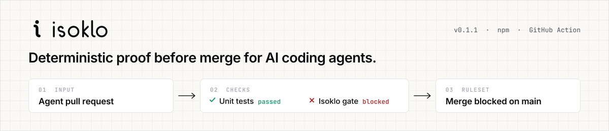

<p align="center">
  
</p>

**Isoklo is a merge gate for AI coding agents.** It blocks a pull request, with the exact line as evidence, when the
change weakens tests, adds a package that doesn't exist, or widens what agents and CI may do. No model is asked for an
opinion: the same change always gets the same verdict.

| Repository | What it is |
|---|---|
| **[isoklo](https://github.com/isoklo/isoklo)** · `v0.1.2` | The zero-dependency CLI and GitHub Action. [npm](https://www.npmjs.com/package/isoklo) · [GitHub Marketplace](https://github.com/marketplace/actions/isoklo) |
| **[isoklo-demo](https://github.com/isoklo/isoklo-demo)** | Four live agent pull requests. Unit tests pass on all four; Isoklo blocks three. |
| **[isoklo-web](https://github.com/isoklo/isoklo-web)** | The interactive showcase at [isoklo.vercel.app](https://isoklo.vercel.app). |

```console
npx isoklo doctor    # which agent reads which instruction file
npx isoklo check     # check this branch before it merges
```

Built by [Euklo](https://euklo.vercel.app), a developer-focused AI agent and LLM tooling studio.
